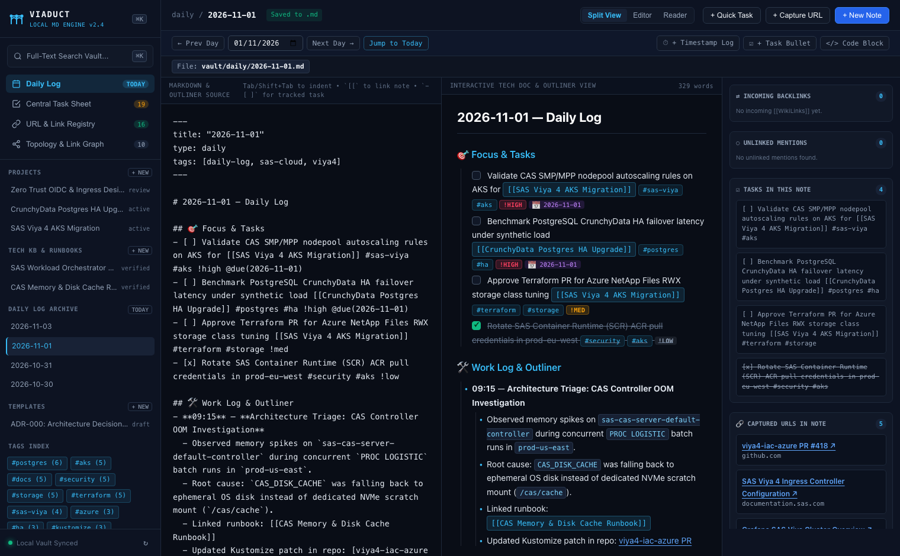
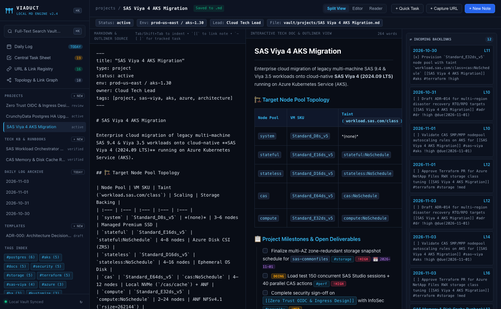
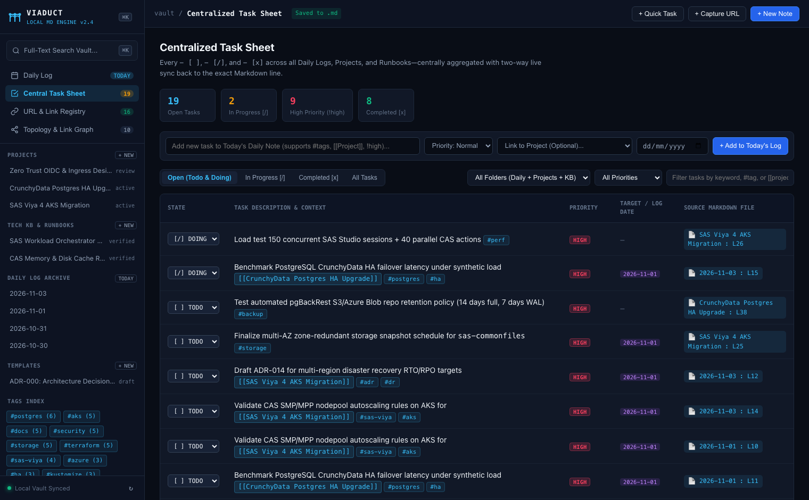
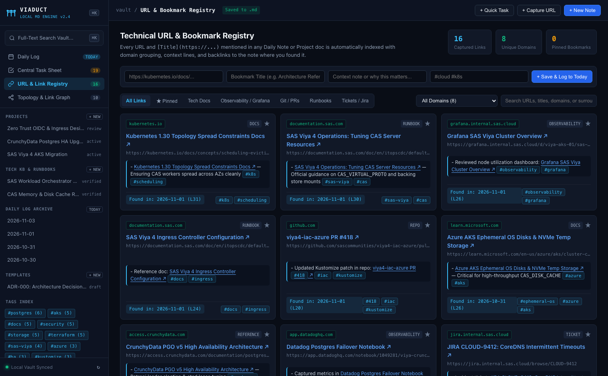
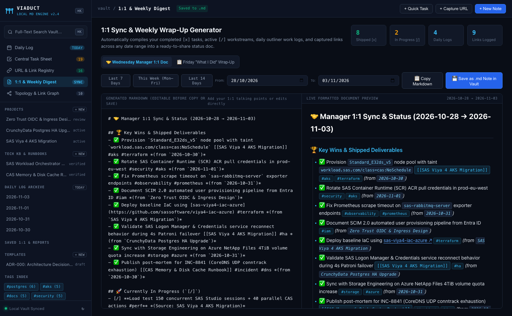
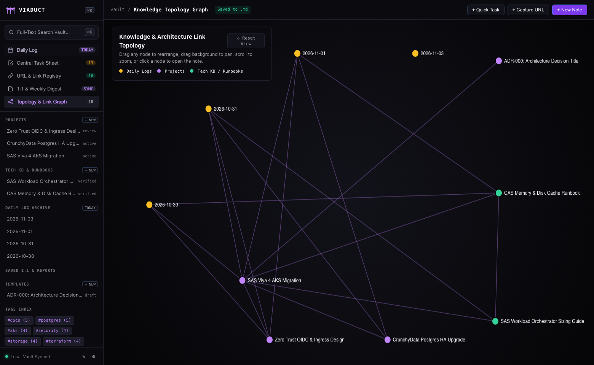

# VIADUCT

**Local-First Technical Knowledge Base, Outliner, Cross-Note Task Sheet & URL Bookmark Engine**

**Viaduct** combines the best parts of local Markdown knowledge bases and daily outliners into a single, zero-dependency, zero-plugin workspace built for Technical Leads, Cloud Architects, and Engineers:

- **100% Local-First Plain Markdown (`vault/*.md`)**: Every note is stored directly on disk as a standard, portable `.md` file organized into `daily/`, `projects/`, `kb/`, and `templates/`.
- **Sub-5ms Full-Text Search (SQLite FTS5)**: Instant full-text search (`⌘K` / `Ctrl+K`) with BM25 relevance ranking, Porter stemming, and highlighted context snippets across all notes, code blocks, and `#tags`.
- **Bidirectional `[[WikiLinks]]` & Unlinked Mentions**: Every note automatically tracks incoming backlinks (with line numbers and surrounding context) and discovers unlinked mentions across your vault—no plugins required.
- **Centralized Cross-Note Task Sheet (Two-Way Sync)**: Add tasks (`- [ ]`, `- [/]`, `- [x]`) on any Daily Log, Project Note, or Runbook. Every task across every day is aggregated into one central **Task Sheet** where toggling status updates the exact line in the source `.md` file on disk.
- **1:1 Sync & Weekly Wrap-Up Generator**: Automatically compiles completed `[x]` deliverables, active `[/]` workstreams, daily outliner work logs, and captured links across any date range into a **Wednesday Manager 1:1 Doc** or **Friday "What I Did" Wrap-Up**—ready to copy or save directly into `vault/reports/`.
- **Built-In URL & Bookmark Registry**: Paste any `[Title](https://...)` or bare URL into any note—or capture links directly from the UI—and Viaduct automatically extracts the domain, classifies the resource (`Docs`, `Observability`, `Git / PRs`, `Runbooks`, `Tickets`), and links back to the exact note and line where you saved it.
- **Interactive Knowledge Topology Graph**: Force-directed visual graph of how your Daily Logs, Projects, and Technical Runbooks connect.

---

## Screenshots

### 1. Daily Log & Outliner (Split Editor + Live Rendered Tech Doc)


### 2. Project Architecture Notes & Incoming Backlinks Inspector


### 3. Centralized Cross-Note Task Sheet (Two-Way `.md` Sync)


### 4. Technical URL & Bookmark Registry


### 5. 1:1 Sync & Weekly Wrap-Up Generator


### 6. Knowledge & Architecture Link Topology Graph


---

## Quick Start (Download & Run Locally)

Viaduct runs entirely on the **Python 3 standard library** (including built-in `sqlite3` with FTS5) and vanilla HTML/CSS/JS. There are **no `npm` packages, no `pip` dependencies, and no build steps** required.

### Prerequisites
- **Python 3.8+** (pre-installed on macOS and most Linux distributions)

### 1. Clone the Repository
```bash
git clone https://github.com/bmccafferty/Viaduct.git
cd Viaduct
```

### 2. Start Viaduct
Use the included launcher script (which starts the server and opens your browser automatically):
```bash
./start.sh
```
Or run the Python server directly:
```bash
python3 server.py
```

Then open **http://127.0.0.1:8420** in your browser.

*(Optional)* To run on a custom port:
```bash
VIADUCT_PORT=9000 python3 server.py
```

---

## Core Features & Workflow

### 1. Daily Log & Outliner (`vault/daily/YYYY-MM-DD.md`)
- Automatically creates today's Markdown log when you open the app.
- **Outliner Keyboard Ergonomics**:
  - `Tab` / `Shift+Tab` — Indent or outdent bullet blocks.
  - `Enter` — Automatically continues outliner bullets and `- [ ]` task items.
  - `[[` — Opens a live autocomplete menu to link to any note in your vault.
- **One-Click Task Rollover**: When previous daily notes have unfinished tasks (`- [ ]` or `- [/]`), a **⟳ Roll Over Unfinished Tasks** button appears in today's banner to pull them forward into today's log while marking the old entry as forwarded (`- [>]`).

### 2. Centralized Task Sheet (Two-Way Markdown Sync)
Write tasks anywhere in your notes using rich inline syntax:
```markdown
- [ ] Validate nodepool autoscaling rules [[Project Name]] #kubernetes !high @due(2026-11-15)
- [/] Benchmark database failover latency #postgres !med
- [x] Rotate container registry pull credentials #security !low
```
- Open **Central Task Sheet** in the sidebar to view, filter, and search all tasks across all daily logs and project files.
- Changing a task's status (`[ ] TODO`, `[/] DOING`, `[x] DONE`) in the Task Sheet immediately rewrites the corresponding line in the underlying `.md` file.

### 3. Technical URL & Bookmark Registry
Never lose a documentation link, Grafana dashboard, GitHub PR, or incident ticket inside old daily notes:
- Every `[Label](https://...)` or raw `https://...` URL written in any note is automatically indexed.
- Filter by category (`★ Pinned`, `Tech Docs`, `Observability / Grafana`, `Git / PRs`, `Runbooks`, `Tickets`), filter by domain, or search across the surrounding note context.
- Use **+ Capture URL** in the top bar to save a bookmark directly to both the Registry and today's Daily Log.

### 4. Split Editor, Live Reader & Code Copy
- Switch seamlessly between **Split View** (Outliner Editor + Interactive Rendered Doc), **Editor**, and **Reader** modes.
- Fenced code blocks (`bash`, `yaml`, `sql`, `python`, etc.) include one-click **Copy Snippet** buttons.

---

## Directory Structure

```text
Viaduct/
├── server.py          # Zero-dependency Python HTTP + SQLite FTS5 indexing server
├── start.sh           # One-command local launcher
├── docs/
│   └── screenshots/   # UI screenshots for documentation
├── static/
│   ├── index.html     # Application shell & modals
│   ├── styles.css     # Dark-slate engineering workbench theme
│   └── app.js         # Live Markdown/Outliner renderer, autocomplete, graph & sync
├── vault/             # Plain-text Markdown (.md) files (auto-seeded with demo notes if empty)
│   ├── daily/         # Daily logs (YYYY-MM-DD.md)
│   ├── projects/      # Architecture & project notes
│   ├── kb/            # Technical knowledge base & operational runbooks
│   └── templates/     # Reusable Markdown templates (e.g. ADR Template)
└── .viaduct/
    └── index.db       # Ephemeral SQLite + FTS5 cache (automatically rebuilt from vault/*.md)
```

> **Note on `.viaduct/index.db`**: Your source of truth is always the plain `.md` files inside `vault/`. The SQLite database in `.viaduct/index.db` is purely an index cache that is automatically rebuilt on startup or when you click the `↻` re-index button in the sidebar.
